# Pleiades 🌌

A fully automated GitOps pipeline that deploys a containerized Flask application to a Kubernetes cluster on AWS, triggered entirely by a Git push. The cluster is configured end to end by an Ansible playbook, and the app is observed with Prometheus and Grafana.

Every commit to this repository automatically builds a new Docker image, pushes it to Docker Hub, updates the Kubernetes manifest with the new image tag, and syncs the live cluster via ArgoCD, with zero manual intervention.

---

## Pipeline Overview

```
Git Push
   │
   ▼
GitHub Actions
   ├── Build Docker image
   ├── Push to Docker Hub (tagged with commit SHA)
   └── Update image tag in deployment.yml
          │
          ▼
       ArgoCD (watching repo)
          └── Detects manifest change
                 └── Auto-syncs to k3s on AWS EC2
                        ├── Flask app live ✅
                        └── ServiceMonitor ──► Prometheus ──► Grafana 📈
```

---

## Stack

| Layer | Technology |
|---|---|
| Application | Python / Flask, prometheus_flask_exporter |
| Containerization | Docker, Docker Hub |
| CI/CD | GitHub Actions |
| Infrastructure | AWS EC2 (t3.medium, ap-south-1) |
| IaC | Terraform |
| Configuration Management | Ansible |
| Kubernetes | k3s |
| Package Management | Helm |
| GitOps | ArgoCD |
| Observability | Prometheus, Grafana (kube-prometheus-stack), ServiceMonitor |
| OS / Runtime | Ubuntu, WSL2 |

---

## How It Works

### 1. Application

The Flask app serves three routes:

- `/` a colorful animated landing page with the Pleiades star cluster and zoom controls (buttons, mouse wheel, or the `+`, `-` and `0` keys). It doubles as a visible end-to-end CI/CD check, since any change to the page goes live through the full pipeline
- `/health` returns `{"status": "ok"}` for health checks
- `/metrics` exposes Prometheus metrics through `prometheus_flask_exporter`

### 2. CI: GitHub Actions

On every push to `main`, a GitHub Actions workflow:
- Builds a Docker image from the Flask app
- Tags it with the commit SHA for precise version tracking
- Pushes it to Docker Hub
- Writes the new image tag back into `k8s/deployment.yml` via a commit

This ensures the repository always reflects exactly what is running in the cluster.

### 3. CD: ArgoCD GitOps

ArgoCD continuously watches this repository. The Application in `argocd/application.yml` points at the `k8s/` directory, which is the source of truth for the Deployment, Service and ServiceMonitor. When the updated image tag lands in `deployment.yml`, ArgoCD syncs it to the k3s cluster automatically, with no `kubectl apply` required.

### 4. Infrastructure: Terraform

The EC2 instance, key pair and security group are provisioned with Terraform.

### 5. Configuration: Ansible

A single playbook turns the bare EC2 instance into a working cluster. It is idempotent, so reruns skip anything already installed. In order, it:

- Updates apt and installs base packages
- Optionally creates a swap file (disabled by default on t3.medium)
- Installs k3s and sets up the kubeconfig for the `ubuntu` user (kubectl ships with k3s)
- Installs Helm
- Installs `kube-prometheus-stack` (Prometheus, Grafana, Prometheus Operator and the ServiceMonitor CRDs) with a trimmed configuration: Alertmanager off, 2 day retention, Prometheus memory limits, and the etcd, scheduler, controller-manager and kube-proxy scrapes disabled because k3s does not expose them
- Installs ArgoCD and patches `argocd-server` to NodePort
- Applies `argocd/application.yml` and waits for Synced/Healthy
- Verifies that Prometheus is scraping the Pleiades target

Wait periods of one to two minutes sit between the heavy installs so pods can settle before the next stage begins.

### 6. Observability: Prometheus + Grafana

A `ServiceMonitor` in `k8s/servicemonitor.yml` tells Prometheus to scrape the Pleiades service on `/metrics` every 15 seconds. Because ArgoCD manages it, monitoring config is versioned in Git like everything else.

The custom Grafana dashboard is exported to `monitoring/pleiades-dashboard.json` and has three panels:

- **Request rate by status code**: `sum(rate(flask_http_request_total[1m])) by (status)`
- **p95 latency**: `histogram_quantile(0.95, sum(rate(flask_http_request_duration_seconds_bucket[1m])) by (le))`
- **Total requests served**: `sum(flask_http_request_total)`

To load it into any Grafana instance: Dashboards > New > Import > upload `monitoring/pleiades-dashboard.json`, then select the Prometheus data source.

### 7. Timing Records

Every command the playbook runs on the instance is timed and appended to `~/timedRecords.txt` in the format:

```
date time | step title | elapsed | exit code
```

Memory readings after each stage and verification results go into the same file. Helper functions are installed at `~/timer.sh`, so the same `timed` wrapper can be used by hand on the instance.

#### Measured on a fresh t3.medium

| Stage | Time |
|---|---|
| apt update and base packages | 27.6s |
| k3s install | 19.5s |
| Helm install | 2.4s |
| Node Ready | 0.6s |
| kube-prometheus-stack install to ready | 108.6s |
| ArgoCD manifest apply | 7.6s |
| ArgoCD pods Ready | 44.4s |
| Application apply to Synced/Healthy | 25.4s |

The settle waits between stages are not included in these numbers.

| Memory checkpoint | Used (of 3836MB) |
|---|---|
| Idle after k3s and Helm | 959MB |
| After monitoring stack | 2382MB |
| After ArgoCD | 2708MB |
| After Pleiades sync | 3151MB |

Prometheus reported 13 targets, all up, and the app exposes 16 metric families on `/metrics`.

---

## Repository Structure

```
Pleiades/
├── app/
│   ├── app.py                  # Flask app: landing page, /health, /metrics
│   ├── requirements.txt
│   └── Dockerfile
├── k8s/
│   ├── deployment.yml          # Kubernetes Deployment (auto-updated by CI)
│   ├── service.yml             # Kubernetes Service (NodePort, named port)
│   └── servicemonitor.yml      # Prometheus ServiceMonitor for the app
├── argocd/
│   └── application.yml         # ArgoCD Application watching k8s/
├── ansible/
│   ├── ansible.cfg
│   ├── vars.yml                # Wait periods, swap toggle, monitoring values
│   └── site.yml                # Full instance setup playbook
├── monitoring/
│   └── pleiades-dashboard.json # Grafana dashboard export
├── terraform/
│   ├── main.tf                 # EC2 provisioning
│   ├── variables.tf
│   └── outputs.tf
├── docs/
│   └── screenshots/
└── .github/
    └── workflows/
        └── build-push.yml      # GitHub Actions CI/CD workflow
```

---

## Screenshots

### GitHub Actions: Workflow Run
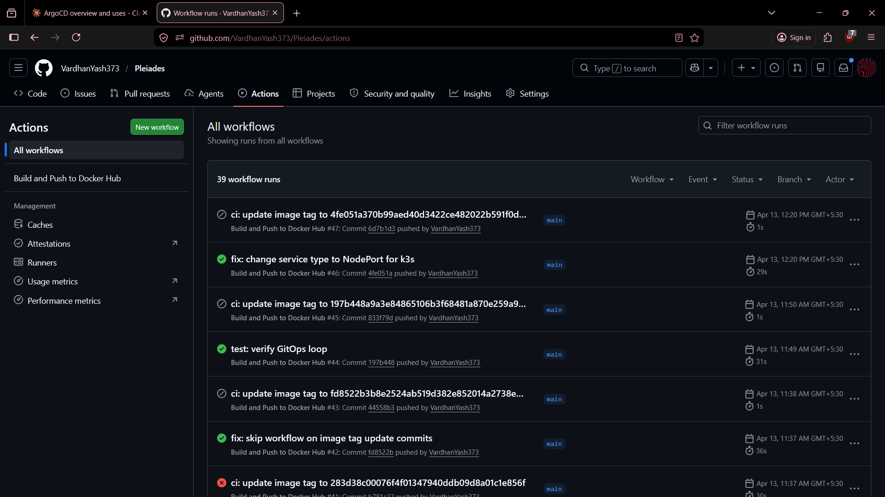

### GitHub Actions: Image Tag Update Step
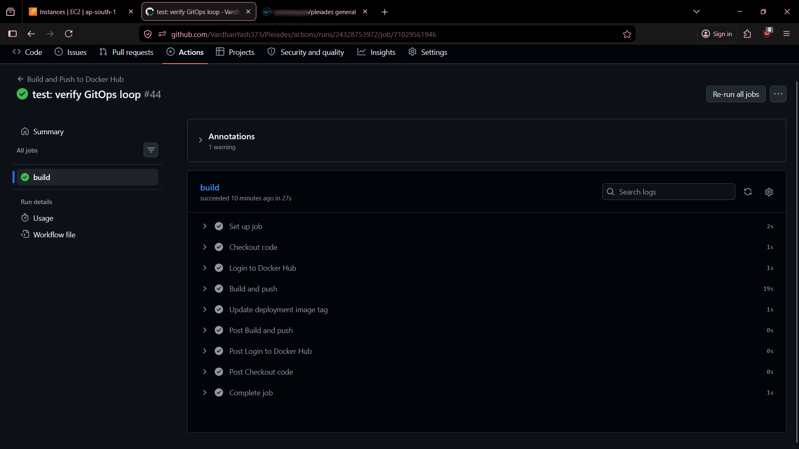

### Docker Hub: SHA-tagged Images
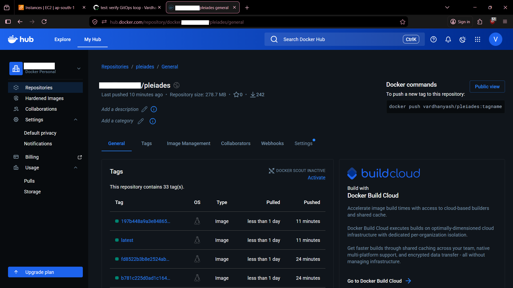

### ArgoCD: Healthy and Synced
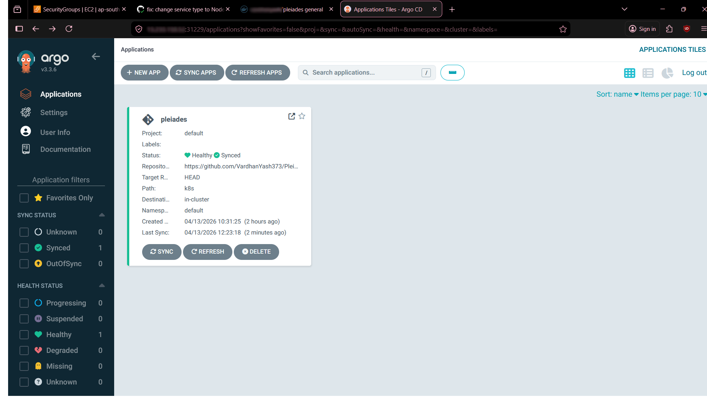

### ArgoCD: Resource Tree
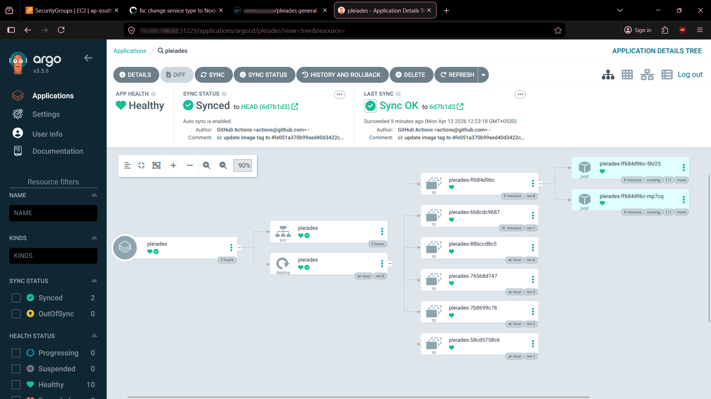

### ArgoCD: IP and Port Exposure
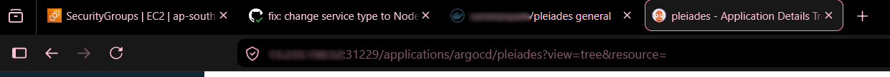

### Kubernetes: Pods Running
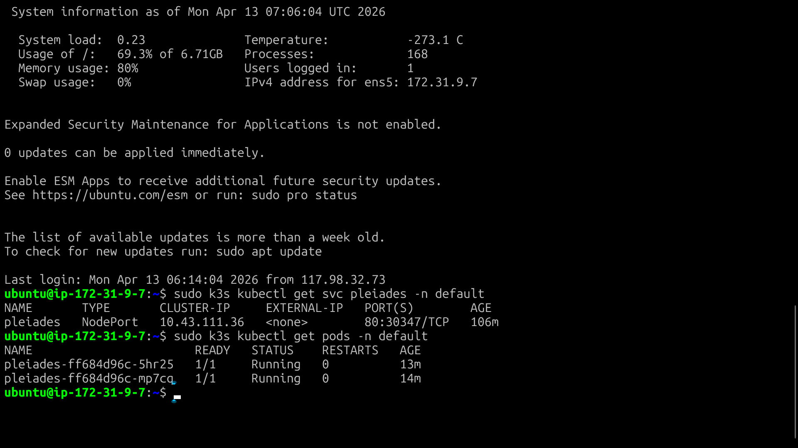

### AWS EC2: Instance Console
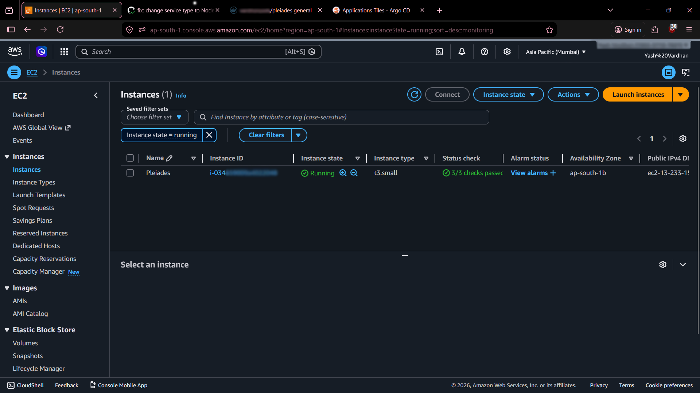

### Flask App: Terminal Response
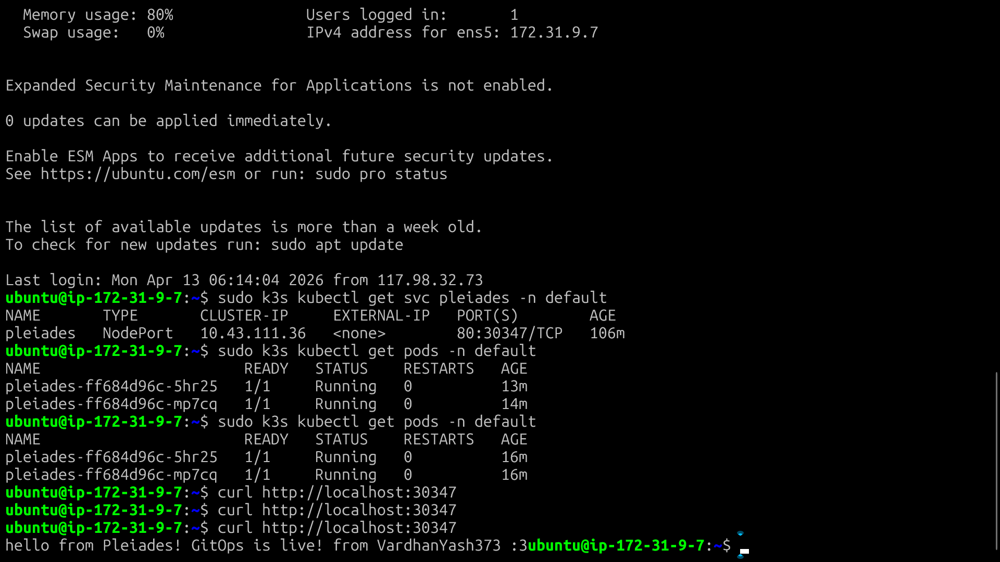

### Flask App: Browser Response
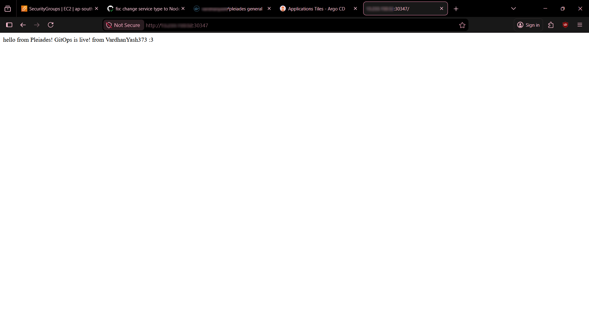

### Prometheus: Pleiades Target UP
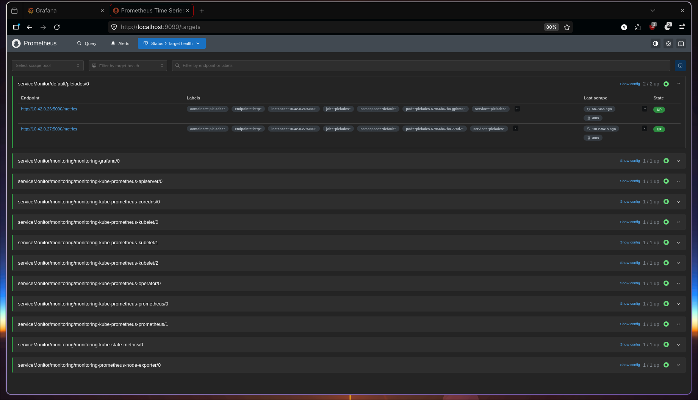

### Grafana: Pleiades Dashboard
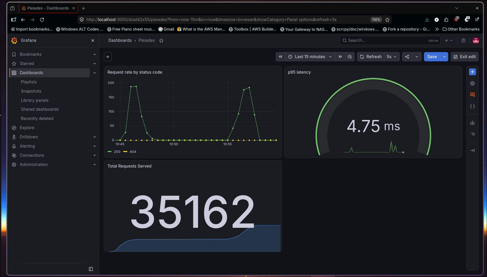

### Flask App: Colorful Landing Page


---

## Key Engineering Decisions

**Why k3s over full Kubernetes?**
k3s is a production-grade lightweight Kubernetes distribution well suited for single-node deployments. It runs comfortably on a single EC2 instance, unlike standard kubeadm setups which require more resources.

**Why commit SHA tags instead of `latest`?**
Tagging images with the commit SHA creates a precise, auditable link between every running container and the exact code that built it. It also prevents ArgoCD from missing updates, since `latest` is a mutable tag that ArgoCD cannot diff against.

**Why ArgoCD over plain `kubectl apply` in CI?**
ArgoCD makes Git the single source of truth for cluster state. It continuously reconciles the cluster against the repo, meaning manual changes to the cluster are detected and corrected automatically. This is the core GitOps pattern.

**Why Ansible on top of Terraform?**
Terraform creates the machine and Ansible configures what runs on it. Keeping them separate means the cluster setup is repeatable on any fresh instance, every step is timed, and nothing depends on remembering manual SSH commands.

**Why kube-prometheus-stack?**
One Helm chart delivers Prometheus, Grafana, the Prometheus Operator and the ServiceMonitor CRDs together, which keeps the monitoring layer declarative and lets the app opt in to scraping with a single manifest.

**Why a trimmed monitoring configuration?**
Alertmanager, short retention and memory limits keep the stack small enough that k3s, ArgoCD, monitoring and the app share a 4GB instance with no swap.

---

## Lessons Learned

- Always add `.gitignore` before running `terraform init`. The AWS provider binary is 600MB+ and will fill your git history if committed accidentally
- t3.micro (1GB RAM) is insufficient for k3s and ArgoCD together. t3.small with a swap file handles those two, but adding the monitoring stack calls for t3.medium (4GB). With the trimmed monitoring values the steady state is about 3.1GB of 3.8GB, so swap is not needed
- ArgoCD on WSL2 requires NodePort exposure to be accessible from a Windows browser. Localhost port-forwarding alone does not work
- GitHub Actions needs explicit `write` permissions on `contents` to push manifest updates back to the repository
- CI commits the image tag back to `main`, so run `git pull --rebase origin main` before every push
- ArgoCD CRDs exceed the client-side apply annotation size limit, so install them with `kubectl apply --server-side --force-conflicts`
- The ServiceMonitor CRD must exist before ArgoCD syncs `servicemonitor.yml`, so the monitoring stack is installed before the ArgoCD application is applied
- Set `serviceMonitorSelectorNilUsesHelmValues=false` so Prometheus discovers ServiceMonitors that are not part of the Helm release
- k3s does not expose etcd, controller-manager, scheduler or kube-proxy metrics the way kubeadm does, so those scrape targets are disabled to avoid permanently down targets
- The Service port must be named for a ServiceMonitor endpoint to reference it
- Ansible sets `KUBECONFIG` only for its own tasks. In a login shell on the instance, run `export KUBECONFIG=~/.kube/config`, otherwise k3s `kubectl` fails reading a root-only file
- Run `kubectl` on the instance, not on the local machine. Locally it has no kubeconfig and falls back to `localhost:8080`
- A shell helper that polls inside a function ignores `set -e`. Add `|| return 1` after commands that must fail the step, or a failed apply leaves the poll loop running until its timeout
- NodePorts and the public IP change on every fresh deploy, so read them again with `kubectl get svc` and `terraform output`

---

## Running This Yourself

### Prerequisites

- AWS account with an IAM user and credentials configured
- Terraform installed
- Ansible installed
- Docker installed
- A Docker Hub account
- An SSH key pair at `~/.ssh/pleiades` and `~/.ssh/pleiades.pub`

### 1. Provision Infrastructure

```bash
cd terraform
terraform init
terraform apply
terraform output -raw instance_ip
```

### 2. Point Ansible at the Instance

Create `ansible/inventory.ini` with the IP from the previous step:

```ini
[pleiades]
ec2 ansible_host=<ec2-ip>
```

### 3. Add GitHub Secrets

In your repository settings, add:
- `DOCKER_USERNAME`
- `DOCKER_PASSWORD`
- `GH_PAT`: a Personal Access Token with repo write permissions

### 4. Push the Manifests to main

ArgoCD syncs from GitHub, so everything under `k8s/` and `argocd/` must be on `main` before the playbook applies the application.

```bash
git pull --rebase origin main
git push origin main
```

### 5. Run the Playbook

```bash
cd ansible
ansible-playbook site.yml
```

This installs k3s, Helm, the monitoring stack and ArgoCD, then applies the Pleiades application.

Optional tagged runs:

```bash
ansible-playbook site.yml --tags resilience
ansible-playbook site.yml --tags snapshot
```

`resilience` measures pod self-heal time, rolling-update downtime and scale-out time. `snapshot` records the steady-state memory footprint.

### 6. Open the App

On the instance:

```bash
ssh -i ~/.ssh/pleiades ubuntu@<ec2-ip>
export KUBECONFIG=~/.kube/config
kubectl get svc pleiades -o jsonpath='{.spec.ports[0].nodePort}'; echo
```

Then browse to `http://<ec2-ip>:<nodeport>/`.

### 7. Access Prometheus and Grafana

On the instance:

```bash
kubectl port-forward -n monitoring svc/monitoring-grafana 3000:80 > /tmp/pf-grafana.log 2>&1 &
kubectl port-forward -n monitoring svc/monitoring-kube-prometheus-prometheus 9090:9090 > /tmp/pf-prom.log 2>&1 &
kubectl get secret -n monitoring monitoring-grafana -o jsonpath="{.data.admin-password}" | base64 -d; echo
```

From your machine, in a separate terminal:

```bash
ssh -i ~/.ssh/pleiades -L 3000:localhost:3000 -L 9090:localhost:9090 ubuntu@<ec2-ip>
```

Grafana is then at `http://localhost:3000` (user `admin`) and Prometheus targets at `http://localhost:9090/targets`. Import `monitoring/pleiades-dashboard.json` into Grafana to get the dashboard.

### 8. Read the Timing Records

```bash
ssh -i ~/.ssh/pleiades ubuntu@<ec2-ip> cat timedRecords.txt
```

Copy the file to your machine before destroying the instance:

```bash
scp -i ~/.ssh/pleiades ubuntu@<ec2-ip>:~/timedRecords.txt .
```

### Cleanup

```bash
cd terraform
terraform destroy
```

---

## Author

Built as a portfolio project to demonstrate end-to-end GitOps with Kubernetes, IaC, configuration management, CI/CD and observability on AWS.
