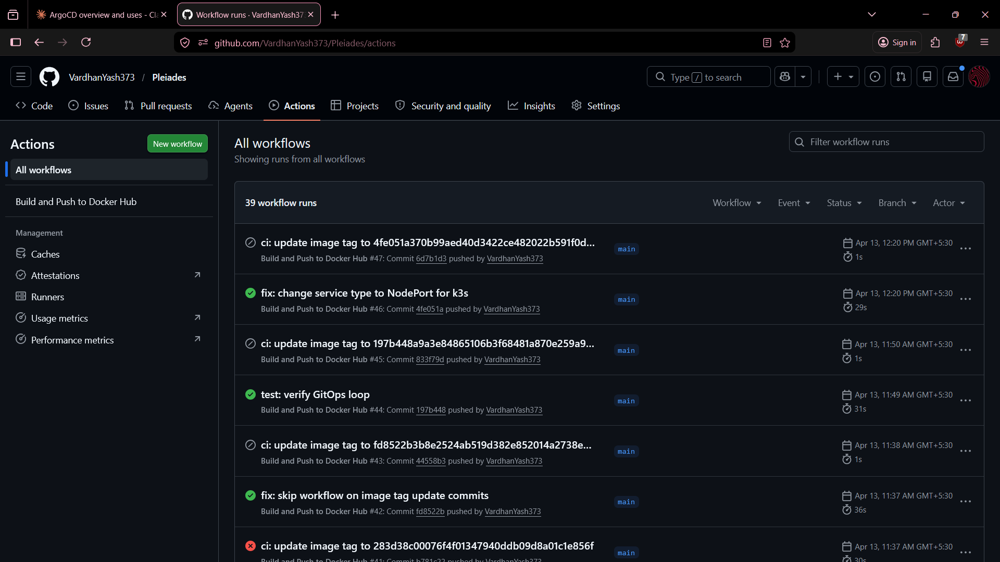
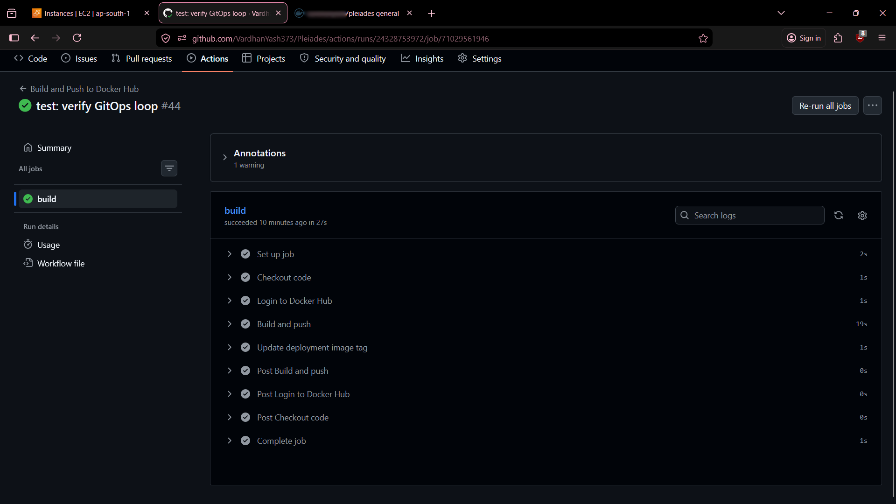
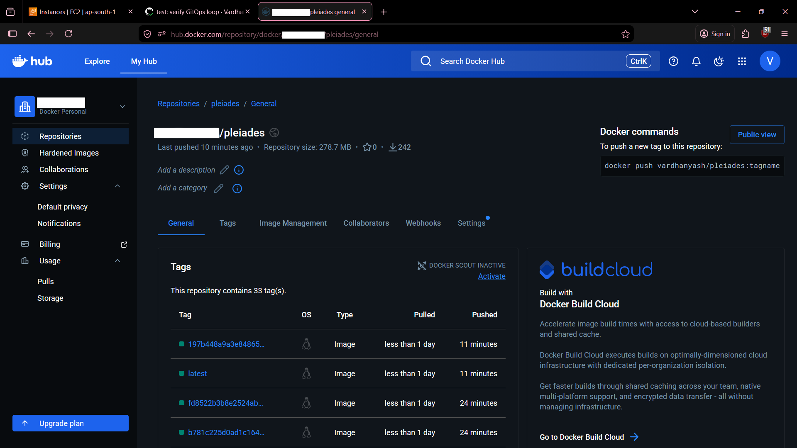
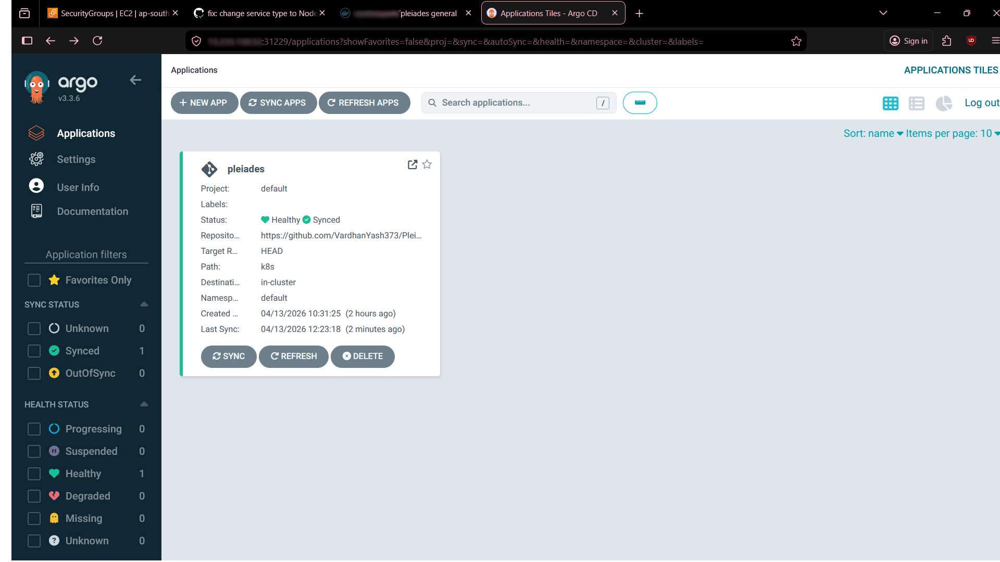
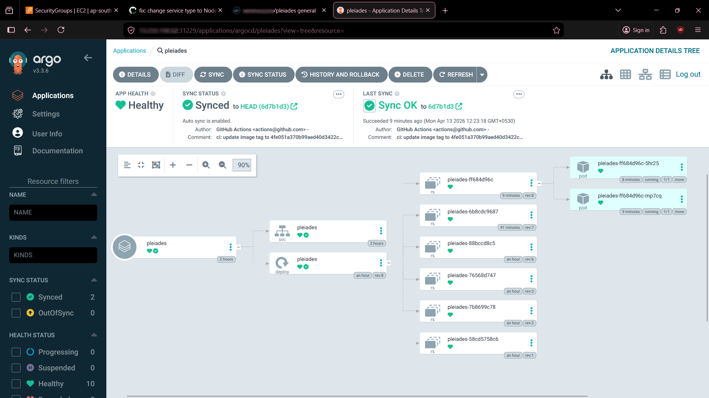
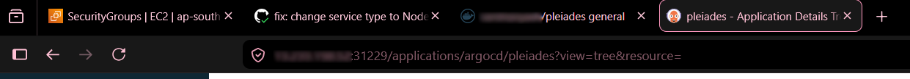
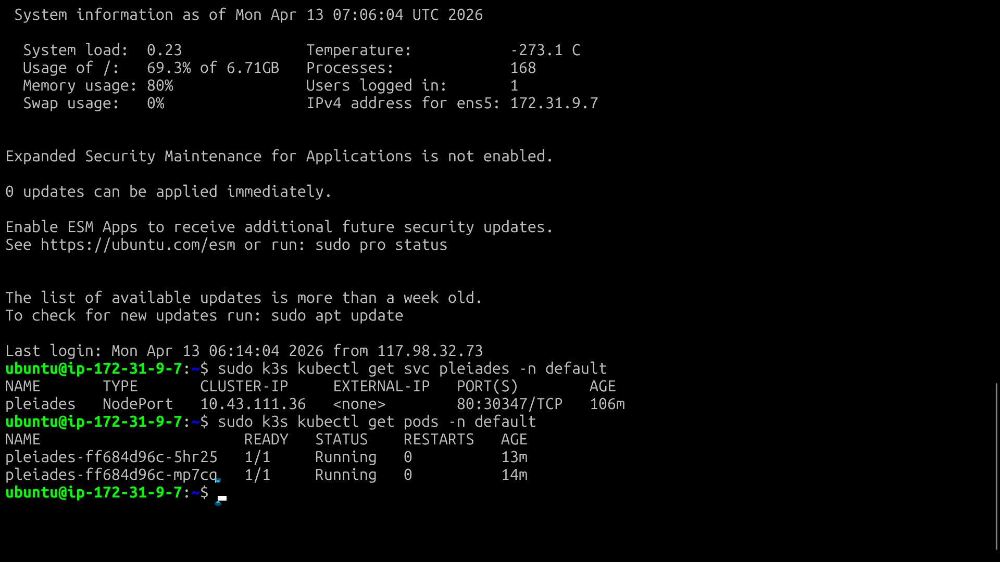
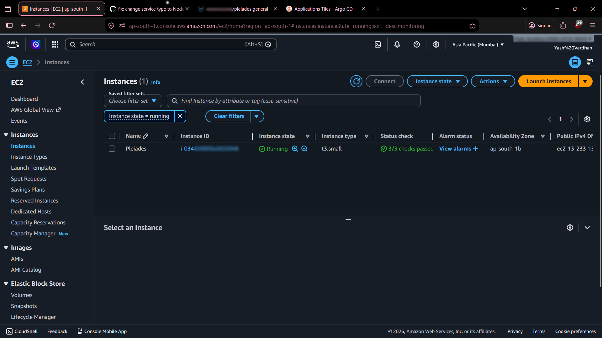
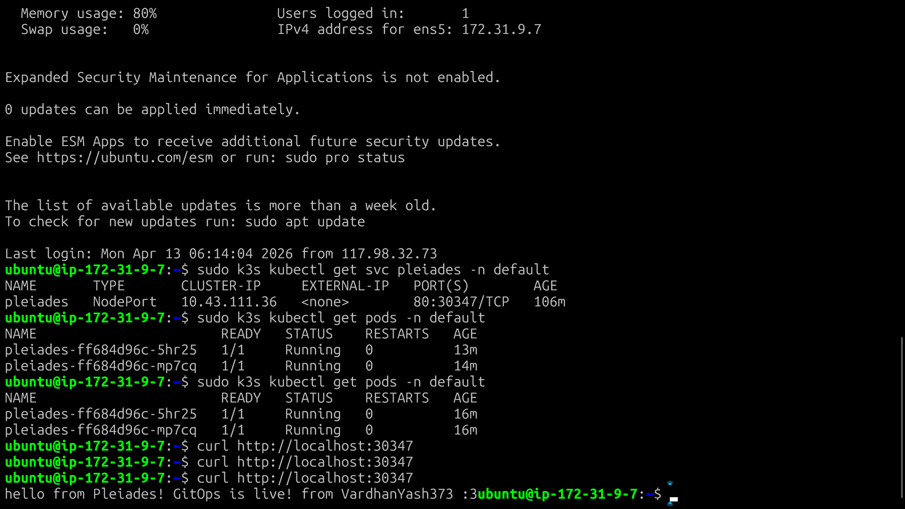
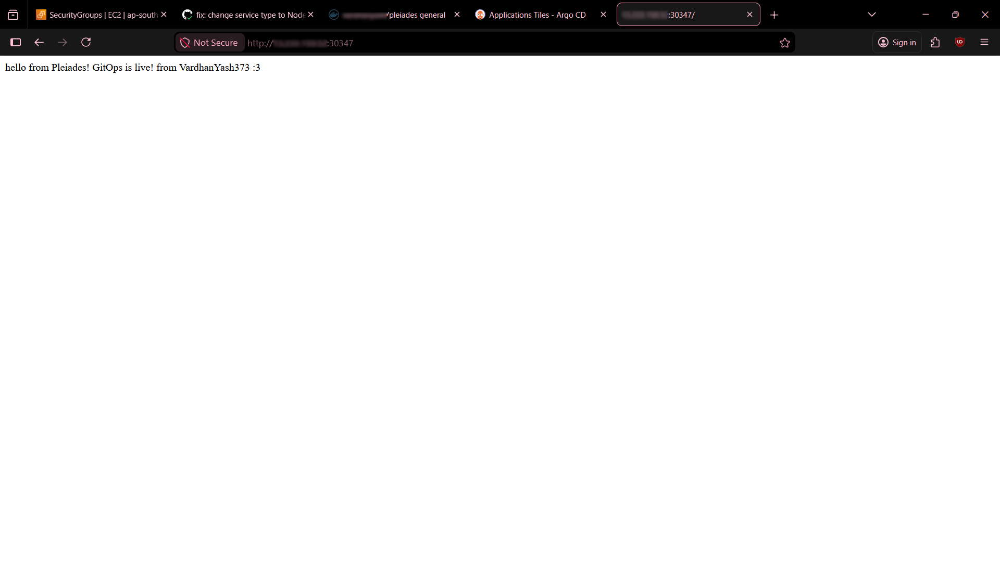

# Pleiades 🌌

A fully automated GitOps pipeline that deploys a containerized Flask application to a Kubernetes cluster on AWS, triggered entirely by a Git push. The cluster itself is configured end to end by an Ansible playbook, and the app is observed with Prometheus and Grafana.

Every commit to this repository automatically builds a new Docker image, pushes it to Docker Hub, updates the Kubernetes manifest with the new image tag, and syncs the live cluster via ArgoCD, with zero manual intervention.

---

## Pipeline Overview

```
Git Push
   │
   ▼
GitHub Actions
   ├── Build Docker image
   ├── Push to Docker Hub (tagged with commit SHA)
   └── Update image tag in deployment.yml
          │
          ▼
       ArgoCD (watching repo)
          └── Detects manifest change
                 └── Auto-syncs to k3s on AWS EC2
                        ├── Flask app live ✅
                        └── ServiceMonitor ──► Prometheus ──► Grafana 📈
```

---

## Stack

| Layer | Technology |
|---|---|
| Application | Python / Flask, prometheus_flask_exporter |
| Containerization | Docker, Docker Hub |
| CI/CD | GitHub Actions |
| Infrastructure | AWS EC2 (t3.medium, ap-south-1) |
| IaC | Terraform |
| Configuration Management | Ansible |
| Kubernetes | k3s |
| Package Management | Helm |
| GitOps | ArgoCD |
| Observability | Prometheus, Grafana (kube-prometheus-stack), ServiceMonitor |
| OS / Runtime | Ubuntu, WSL2 |

---

## How It Works

### 1. CI: GitHub Actions

On every push to `main`, a GitHub Actions workflow:
- Builds a Docker image from the Flask app
- Tags it with the commit SHA for precise version tracking
- Pushes it to Docker Hub
- Writes the new image tag back into `k8s/deployment.yml` via a commit

This ensures the repository always reflects exactly what is running in the cluster.

### 2. CD: ArgoCD GitOps

ArgoCD continuously watches this repository. When it detects the updated image tag in `deployment.yml`, it automatically syncs the change to the k3s cluster running on AWS EC2, with no `kubectl apply` required. The `k8s/` directory is the source of truth for the Deployment, Service and ServiceMonitor.

### 3. Infrastructure: Terraform

The EC2 instance, key pair and security group are provisioned with Terraform.

### 4. Configuration: Ansible

A single playbook turns the bare EC2 instance into a working cluster. It is idempotent, so reruns skip anything already installed. In order, it:

- Updates apt and installs base packages
- Installs k3s and sets up the kubeconfig for the `ubuntu` user (kubectl ships with k3s)
- Installs Helm
- Installs `kube-prometheus-stack` (Prometheus, Grafana, Prometheus Operator and the ServiceMonitor CRDs)
- Installs ArgoCD, patches `argocd-server` to NodePort and applies `application.yml`
- Verifies that Prometheus is scraping the Pleiades target

Wait periods of one to two minutes sit between the heavy installs so pods can settle before the next stage begins.

### 5. Observability: Prometheus + Grafana

The Flask app exposes `/metrics` through `prometheus_flask_exporter`. A `ServiceMonitor` in `k8s/servicemonitor.yml` tells Prometheus to scrape the Pleiades service every 15 seconds. Because ArgoCD manages the ServiceMonitor, monitoring config is versioned in Git like everything else. Grafana ships with the Kubernetes dashboards from the chart, and the app's request rate and latency are available from the `flask_http_*` metrics.

### 6. Timing Records

Every command the playbook runs on the instance is timed and appended to `~/timedRecords.txt` in the format:

```
date time | step title | elapsed | exit code
```

Memory readings after each stage and verification results are appended to the same file. Helper functions are installed at `~/timer.sh` so the same `timed` wrapper can be used by hand on the instance.

---

## Repository Structure

```
Pleiades/
├── app/
│   ├── app.py                  # Flask application with /health and /metrics
│   ├── requirements.txt
│   └── Dockerfile
├── k8s/
│   ├── deployment.yml          # Kubernetes Deployment (auto-updated by CI)
│   ├── service.yml             # Kubernetes Service (NodePort, named port)
│   └── servicemonitor.yml      # Prometheus ServiceMonitor for the app
├── ansible/
│   ├── ansible.cfg
│   ├── inventory.ini           # EC2 public IP
│   ├── vars.yml                # Versions, wait periods, monitoring values
│   └── site.yml                # Full instance setup playbook
├── terraform/
│   ├── main.tf                 # EC2 provisioning
│   ├── variables.tf
│   └── outputs.tf
├── application.yml             # ArgoCD Application
└── .github/
    └── workflows/
        └── build-push.yml      # GitHub Actions CI/CD workflow
```

---

## Screenshots

### GitHub Actions: Workflow Run


### GitHub Actions: Image Tag Update Step


### Docker Hub: SHA-tagged Images


### ArgoCD: Healthy and Synced


### ArgoCD: Resource Tree


### ArgoCD: IP and Port Exposure


### Kubernetes: Pods Running


### AWS EC2: Instance Console


### Flask App: Terminal Response


### Flask App: Browser Response


### Prometheus: Pleiades Target UP


### Grafana: Pleiades Dashboard


---

## Key Engineering Decisions

**Why k3s over full Kubernetes?**
k3s is a production-grade lightweight Kubernetes distribution well suited for single-node deployments. It runs comfortably on a single EC2 instance with swap configured, unlike standard kubeadm setups which require more resources.

**Why commit SHA tags instead of `latest`?**
Tagging images with the commit SHA creates a precise, auditable link between every running container and the exact code that built it. It also prevents ArgoCD from missing updates, since `latest` is a mutable tag that ArgoCD cannot diff against.

**Why ArgoCD over plain `kubectl apply` in CI?**
ArgoCD makes Git the single source of truth for cluster state. It continuously reconciles the cluster against the repo, meaning manual changes to the cluster are detected and corrected automatically. This is the core GitOps pattern.

**Why Ansible on top of Terraform?**
Terraform creates the machine and Ansible configures what runs on it. Keeping them separate means the cluster setup is repeatable on any fresh instance, every step is timed, and nothing depends on remembering manual SSH commands.

**Why kube-prometheus-stack?**
One Helm chart delivers Prometheus, Grafana, the Prometheus Operator and the ServiceMonitor CRDs together, which keeps the monitoring layer declarative and lets the app opt in to scraping with a single manifest.

---

## Lessons Learned

- Always add `.gitignore` before running `terraform init`. The AWS provider binary is 600MB+ and will fill your git history if committed accidentally
- t3.micro (1GB RAM) is insufficient for running k3s and ArgoCD simultaneously, and adding the full monitoring stack on top calls for t3.medium (4GB)
- ArgoCD on WSL2 requires NodePort exposure to be accessible from a Windows browser. Localhost port-forwarding alone does not work
- GitHub Actions needs explicit `write` permissions on `contents` to push manifest updates back to the repository
- ArgoCD CRDs exceed the client-side apply annotation size limit, so install them with `kubectl apply --server-side --force-conflicts`
- The ServiceMonitor CRD must exist before ArgoCD syncs `servicemonitor.yml`, so the monitoring stack is installed before the ArgoCD application is applied
- Set `serviceMonitorSelectorNilUsesHelmValues=false` so Prometheus discovers ServiceMonitors that are not part of the Helm release
- k3s does not expose etcd, controller-manager, scheduler or kube-proxy metrics the way kubeadm does, so those scrape targets are disabled to avoid permanently down targets
- The Service port must be named for a ServiceMonitor endpoint to reference it

---

## Running This Yourself

### Prerequisites

- AWS account with an IAM user and credentials configured
- Terraform installed
- Ansible installed
- Docker installed
- A Docker Hub account
- An SSH key pair at `~/.ssh/pleiades` and `~/.ssh/pleiades.pub`

### 1. Provision Infrastructure

```bash
cd terraform
terraform init
terraform apply
terraform output -raw instance_ip
```

### 2. Point Ansible at the Instance

Put the IP from the previous step into `ansible/inventory.ini`:

```ini
[pleiades]
ec2 ansible_host=<ec2-ip>
```

### 3. Add GitHub Secrets

In your repository settings, add:
- `DOCKER_USERNAME`
- `DOCKER_PASSWORD`
- `GH_PAT`: a Personal Access Token with repo write permissions

### 4. Push the Manifests to main

ArgoCD syncs from GitHub, so `k8s/service.yml` and `k8s/servicemonitor.yml` must be on `main` before the playbook applies the application.

```bash
git push origin main
```

### 5. Run the Playbook

```bash
cd ansible
ansible-playbook site.yml
```

This installs k3s, Helm, the monitoring stack and ArgoCD, then applies the Pleiades application.

Optional tagged runs:

```bash
ansible-playbook site.yml --tags resilience
ansible-playbook site.yml --tags snapshot
```

`resilience` measures pod self-heal time, rolling-update downtime and scale-out time. `snapshot` records the steady-state memory footprint.

### 6. Access Prometheus and Grafana

On the instance:

```bash
kubectl port-forward -n monitoring svc/monitoring-grafana 3000:80 >/dev/null 2>&1 &
kubectl port-forward -n monitoring svc/monitoring-kube-prometheus-prometheus 9090:9090 >/dev/null 2>&1 &
kubectl get secret -n monitoring monitoring-grafana -o jsonpath="{.data.admin-password}" | base64 -d; echo
```

From your machine, in a separate terminal:

```bash
ssh -i ~/.ssh/pleiades -L 3000:localhost:3000 -L 9090:localhost:9090 ubuntu@<ec2-ip>
```

Grafana is then at `http://localhost:3000` (user `admin`) and Prometheus at `http://localhost:9090/targets`.

### 7. Read the Timing Records

```bash
ssh -i ~/.ssh/pleiades ubuntu@<ec2-ip> cat timedRecords.txt
```

### Cleanup

```bash
cd terraform
terraform destroy
```

---

## Author

Built as a portfolio project to demonstrate end-to-end GitOps with Kubernetes, IaC, configuration management, CI/CD and observability on AWS.
